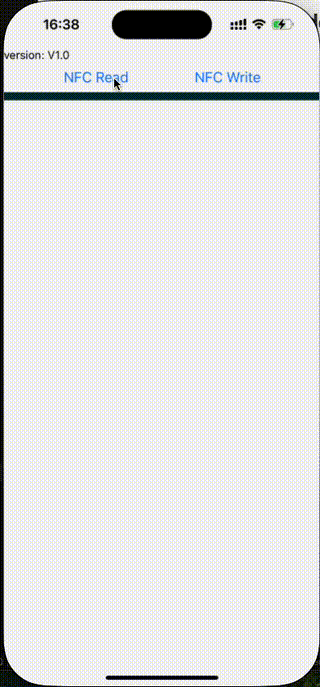
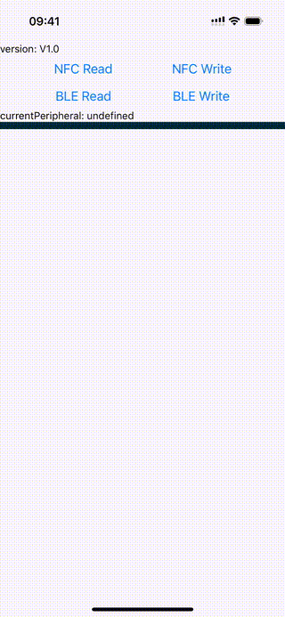

[English](./README.md) | [中文](./README-zh.md)

# Native Demo

For related introductions, please refer to ios-demo and android-demo.

# RN Demo

Supports all IPSOv1 and IPSOv2 read/write

### Run demo

```shell
yarn install

#iOS
yarn pod && yarn ios

#Android
yarn android
```




# SDK Installation

> You may need native configuration related to Bluetooth and NFC, please refer to the instructions.
> nfc: https://github.com/revtel/react-native-nfc-manager
> ble: https://innoveit.github.io/react-native-ble-manager/install/

```shell
#Third-party native dependencies
yarn add react-native-ble-manager@11.5.1
yarn add react-native-nfc-manager@2.1.8
yarn add react-native-device-info@14.0.4
yarn add react-native-mmkv@2.11.0
yarn add react-native-permissions@3.10.1 #Native permissions-related, mainly used for Android Bluetooth
yarn add react-native-android-location-enabler@^2.0.1 #Android location permission, used for Bluetooth
yarn add react-native-localize@1.4.3

#SDK Installation
yarn add toolbox-sdk@file:path/to/toolbox-sdk-0.x.xx.tgz

#It is necessary to apply the relevant patch to modify the third-party library, or you can add the command to the postinstall section of package.json to execute it automatically after installing dependencies.
npx toobox-patch init

#package.json
...
"postinstall": "npx toolbox-patch init"

```

# Quick Start

## NFC

```typescript
import { useCommService, NFC } from 'toolbox-sdk';
const { read, write } = useCommService();
//Read
const deviceInfo = await read('nfc');
//deviceEui
const deviceEui = deviceInfo.deviceEui;
//Write
await write(deviceInfo, 'nfc');


//Boot (requires reading device information first
await NFC.powerOn();

//Shut down (requires reading device information first)
await NFC.powerOff();

//Restart
await NFC.reset();

//NFC listen event, details see NfcModal.tsx
...
useEffect(() => {
	const beforeStartListener = NFC.addEventListener(NfcTrackerEvents.beforeStart, onBeforeStart);
	const startListener = NFC.addEventListener(NfcTrackerEvents.start, onStart);
	const progressListener = NFC.addEventListener(NfcTrackerEvents.progress, onProgressChange);
	const errorListener = NFC.addEventListener(NfcTrackerEvents.error, onError);
	const successListener = NFC.addEventListener(NfcTrackerEvents.success, onSuccess);
	return () => {
		beforeStartListener.remove();
		startListener.remove();
		progressListener.remove();
		errorListener.remove();
		successListener.remove();
	};
}, []);

//Before NFC starts reading
const onBeforeStart = () => {
	setNfcModalTitle('NFC Modal');
	setNfcModalMessage('Please scan the NFC tag');
	setNfcModalVisible(true);
};

//NFC starts reading
const onStart = (commandName: NfcCommandName) => {
	setNfcModalTitle(NfcUtils.getTitle(commandName));
	setNfcModalMessage('starting...');
	setNfcModalVisible(true);
};

//NFC Reading Progress
const onProgressChange = (progress: number) => {
	setNfcModalMessage(`${Math.round(progress * 100)}%`);
};
//NFC read error
const onError = (error: any, errorMessage: string) => {
	setNfcModalMessage(errorMessage);
	NFC.setErrorAlertMessage(errorMessage);
	setTimeout(() => {
		setNfcModalVisible(false);
	}, 500);
};
//NFC read successful
const onSuccess = (commandName: NfcCommandName, _message?: string) => {
	setNfcModalMessage(_message ?? 'success');
	setTimeout(() => {
		setNfcModalVisible(false);
	}, 500);
};
```

## Bluetooth

- Bluetooth requires additional connection and authentication steps compared to NFC before performing related read/write operations.
- All Bluetooth commands need to be verified with a password segment.
- The password is globally managed by the DevicePasswordManager, and after successful authentication, subsequent passwords will be directly retrieved from the DevicePasswordManager.

```typescript

import { useCommService } from 'toolbox-sdk';
const { read, write } = useCommService();
// Read in connected state
const deviceInfo = await read('ble');
// Write in connected state
await write(deviceInfo, 'ble');

// You can determine if Bluetooth is connected to a device by getting the current connected peripheral, an empty value indicates no connection
const currentPeripheral = BleManager.getCurrentConnectedPeripheral();

// In the case of no connection, first enable Bluetooth scanning
BleManager.scan();

// Listen to Bluetooth events
useEffect(() => {
    // Start searching for peripheral devices
    const scanListener = BleManager.on(BleEvent.scan, onScan);
    // Event when a peripheral device is discovered
    const discoverListener = BleManager.on(BleEvent.discover, onDiscoverPeripheral);
    // Event when scanning stops
    const stopScanListener = BleManager.on(BleEvent.stopScan, onStopScan);
    // Disconnect event
    const disconnectListener = BleManager.on(BleEvent.disconnect, onDisconnect);
    return () => {
    	discoverListener.off();
    	stopScanListener.off();
    	disconnectListener.off();
    };
}, []);

//SDK will filter out non-milesight devices.
const onDiscoverPeripheral = () => {
    //Peripheral devices are discovered, this callback will be called continuously as new devices are found
    const peripherals = BleManager.getAllPeripherals();
    setPeripherals(peripherals);
};

//Render peripheral devices
const renderItem = ({ item }: { item: Peripheral }) => {
    const isConnected = item.connected || item.id === BleManager.getCurrentConnectedPeripheral()?.id;
    const isConnecting = connecting && cidRef.current === item.id;
    const hasConnectedCount = item.connectCount > 0;
    let statusText = '';
    if (isConnecting) {
        statusText = 'connecting...';
    } else if (isConnected) {
        statusText = 'Connected';
    } else if (hasConnectedCount) {
        statusText = 'been connected';
    } else {
        statusText = 'not connected';
    }
    return (
        <Pressable style={styles.item} onPress={() => startConnect(item.id)}>
            <Text>{item.name}</Text>
            <View style={styles.rightView}>
                <Text>{statusText}</Text>
            </View>
        </Pressable>
    );
};

//Certification and Connection of Peripheral Devices
const startConnect = async (id: string) => {
    try {
        //Bluetooth connection requires password authentication, and subsequent Bluetooth communication is carried out by using the authenticated password obtained from the DevicePasswordManager.
        const {password = ''} = DevicePasswordManager.getPasswordById(id, false);
        if (!password) {
            //No binding password, requires a password prompt to pop up, see related logic in PasswordContent.tsx.
            setPasswordContentVisible(true);
            return;
        }
        //In bound status, direct connection is possible.
        await connectWithPassword(id, password);
    } catch (error) {
        setErrorMessage(getErrorMessage(error));
    } finally {
        setConnecting(false);
    }
};

//Extract Bluetooth connection and authentication actions from useCommService
const { bleConnect, bleAuth } = useCommService();
const connectWithPassword = async (id: string, password: string) => {
    try {
        await bleConnect(id);
        await bleAuth(id, password);
        await sleep(10);
        //After certification, the peripheral devices of the current connection can be obtained from BleManager.
        onConnectSuccess(BleManager.getCurrentConnectedPeripheral());
    } catch (error) {
        setErrorMessage(getErrorMessage(error));
    } finally {
        setConnecting(false);
    }
};


```
