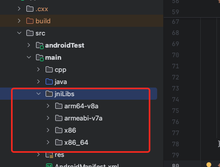

# Android Demo

Android 示例应用，演示如何通过 NFC 与 Milesight 设备进行通信，实现 Flash 数据的读取与写入功能。仅支持IPSOV1设备。

## 项目概述

本Demo使用 Kotlin + Jetpack Compose 构建，通过自定义的 `NFCService` 和 `NFCCore` 封装了完整的 NFC 通信协议栈，支持从 NFC 标签读取设备配置信息，以及将新的配置信息写入标签。

## NFC接入
将uses-permission添加到您的AndroidManifest.xml中：

```xml
 <uses-permission android:name="android.permission.NFC" />
 ```


## codec编解码库接入
- 引入jniLibs，保证目录相同

- build.gradle.kts 中增加so库声明
```kotlin
    sourceSets {
        getByName("main") {
            jniLibs.srcDirs("src/main/jniLibs")
        }
    }
```


## 核心功能：readFlash 与 writeFlash

### readFlash - 读取 Flash 数据

#### 调用方式

在 `MainActivity.kt` 中的调用示例：

```kotlin
val activity = context as MainActivity
activity.service.readFlash { result, flashInfo, rawData ->
    if (result && flashInfo != null) {
        // 保存读取到的数据
        activity.flashInfo = flashInfo
        activity.rawData = rawData
        // 使用解析后的配置信息
        val buttonLight = flashInfo["buttonLight"] as Int
    }
}
```

#### 方法声明

```kotlin
fun readFlash(callback: (Boolean, Map<String, Any?>?, List<Int>?) -> Unit)
```

**参数说明：**
- `callback`: 回调函数，接收三个参数：
  - `result: Boolean` - 操作是否成功
  - `flashInfo: Map<String, Any?>?` - 解析后的设备配置信息（如 `buttonLight` 等）
  - `rawData: List<Int>?` - 原始 Flash 数据（去除头部和尾部后的纯数据部分）

#### 实现步骤详解

`readFlash` 的完整执行流程如下：

**步骤 1：启动 NFC 标签检测**
```kotlin
startDetection { success ->
    // 检测 NFC 标签是否可用
}
```
- 调用 `nfcCore.requestTechnology("NfcA")` 请求 NFC-A 技术
- 显示提示对话框："Please scan the NFC tag"
- 等待用户将 NFC 标签靠近手机
- 检测成功后返回 `success = true`

**步骤 2：发送读取 Flash 命令**
```kotlin
sendCommand(NFC_COMMAND_READ_FLASH, null) { success, length ->
    // length 为需要接收的数据总长度
}
```
- 延迟 300ms 后执行（确保标签稳定）
- 检查标签是否可写（`checkWriteable`）
- 构建读取命令字节：
  - 命令前缀：`A6F0FF` + `4d3c2b1a78563412`（Magic） + `01`（Version）
  - 命令类型：`01`（READ_PKT）
  - 操作类型：`05`（读取 Flash）
  - 填充到 134 字节
- 通过 `nfcCore.transceive()` 发送命令
- 检查响应并验证标签可读性（`checkReadable`）
- 获取 ACK 响应中的数据长度（`getAckDataLength`）

**步骤 3：分批次接收数据**
```kotlin
receiveDataWithLength(length) { response ->
    // response 为完整的原始数据
}
```
- 根据数据长度计算需要接收的包数：`ceil(length / 64.0)`
- 循环调用 `receiveDataWithCount()` 逐包接收：
  - 每次检查标签可读性（`checkReadable`）
  - 发送 `NFC_COMMAND_RECEIVE_DATA` 命令（`3AF0FF`）
  - 接收 64 字节数据并追加到结果列表
  - 更新进度显示
- 所有包接收完成后返回完整数据

**步骤 4：解析 Flash 数据**
```kotlin
val sliceData = response.safeSubList(0, length)
val rawData = sliceData.safeSubList(128, sliceData.size - 128)
val flashInfo = ToolboxSdkModule().getFlashInfo(sliceData)
```
- 提取有效数据：从完整响应中截取指定长度的数据
- 提取原始数据：去除前 128 字节头部和后 128 字节尾部
- 调用 `ToolboxSdkModule().getFlashInfo()` 解析配置信息：
  - 通过 JNI 调用底层 C++ 库 `codec-lib`
  - 将字节数组转换为 JSON 字符串
  - 包含设备配置参数（如 `buttonLight` 等）
- 将 JSON 字符串转换为 `Map<String, Any?>`

**步骤 5：返回结果**
```kotlin
callback(true, jsonToMap(flashInfo), rawData)
nfcCore.cancelTechnologyRequest()
showModal("success")
```
- 调用回调函数返回解析结果
- 取消 NFC 请求
- 显示成功提示

#### 流程图

```
readFlash()
    │
    ├─→ startDetection()
    │       ├─→ requestTechnology("NfcA")
    │       └─→ 等待标签靠近
    │
    ├─→ sendCommand(READ_FLASH)
    │       ├─→ checkWriteable()
    │       ├─→ 构建命令字节
    │       ├─→ transceive(命令)
    │       ├─→ checkReadable()
    │       └─→ getAckDataLength() → 获取数据长度
    │
    ├─→ receiveDataWithLength(length)
    │       ├─→ 计算包数: ceil(length / 64)
    │       └─→ 循环接收:
    │               ├─→ checkReadable()
    │               ├─→ transceive(RECEIVE_DATA)
    │               └─→ 追加数据到结果
    │
    ├─→ 解析数据
    │       ├─→ 提取 rawData (去除头尾)
    │       └─→ ToolboxSdkModule().getFlashInfo()
    │
    └─→ callback(result, flashInfo, rawData)
```

---

### writeFlash - 写入 Flash 数据

#### 调用方式

在 `MainActivity.kt` 中的调用示例：

```kotlin
val activity = context as MainActivity

// 必须先读取 Flash，获取原始数据
if (activity.flashInfo == null || activity.rawData == null) {
    ModalManager.show("error", "please read flash first")
    return
}

// 构建新的配置信息（合并原有配置和新配置）
val newDeviceSettingInfo = mapOf("buttonLight" to writeButtonLight.toInt())
val newFlashInfo = activity.flashInfo!! + newDeviceSettingInfo

// 调用写入方法
activity.service.writeFlash(
    settingJSON = newFlashInfo,           // 新的完整配置信息
    newDeviceSettingInfo = activity.flashInfo!!,  // 原有配置（用于对比）
    rawData = activity.rawData!!,         // 原始数据
    callback = { success ->
        if (success) {
            ModalManager.show("success", "write flash success")
        } else {
            ModalManager.show("error", "write flash failed")
        }
    }
)
```

#### 方法签名

```kotlin
fun writeFlash(
    settingJSON: Map<String, Any?>,      // 新的完整配置信息（JSON 格式）
    newDeviceSettingInfo: Map<String, Any?>,  // 原有配置信息
    rawData: List<Int>,                   // 从 readFlash 获取的原始数据
    callback: (Boolean) -> Unit           // 写入结果回调
)
```

**参数说明：**
- `settingJSON`: 包含所有配置项的 Map，会转换为 JSON 字符串传递给底层 SDK
- `newDeviceSettingInfo`: 原有的配置信息（用于数据校验）
- `rawData`: 从 `readFlash` 获取的原始 Flash 数据（去除头尾后的部分）
- `callback`: 写入操作完成后的回调，`true` 表示成功，`false` 表示失败

#### 实现步骤详解

`writeFlash` 的完整执行流程如下：

**步骤 1：参数校验**
```kotlin
if (rawData.isEmpty()) {
    _callback(false, "raw data is empty")
    return
}
```
- 检查 `rawData` 是否为空，为空则直接返回失败

**步骤 2：启动 NFC 标签检测**
```kotlin
startDetection { detectionSuccess ->
    if (!detectionSuccess) {
        _callback(false, "detect failed")
        return
    }
    // 继续后续步骤
}
```
- 与 `readFlash` 相同，检测并连接 NFC 标签

**步骤 3：生成新的 Flash 数据**
```kotlin
val flashInfo = ToolboxSdkModule().setFlashInfo(
    rawData, 
    JSONObject(settingJSON).toString()
)
val code = flashInfo["code"] as? Int ?: 0
```
- 调用 `ToolboxSdkModule().setFlashInfo()`：
  - 通过 JNI 调用底层 C++ 库
  - 将新的配置信息（JSON 字符串）合并到原始数据中
  - 生成新的完整 Flash 数据（包含头部和尾部）
- 检查返回码：
  - `code == 1`: 成功生成新数据
  - 其他值: 生成失败（如配置格式错误、数据校验失败等）

**步骤 4：提取写入参数**
```kotlin
if (code == 1) {
    val newRawData = flashInfo["rawData"] as? List<Int>
    val resultDict = jsonToMap(flashInfo["result"] as? String)
    val dataSize = resultDict["datasize"] as? Int
}
```
- 从返回结果中提取：
  - `newRawData`: 新的完整 Flash 数据（包含头尾）
  - `dataSize`: 需要写入的数据大小（字节数）

**步骤 5：发送写入 Flash 命令**
```kotlin
sendCommand(
    NFC_COMMAND_WRITE_FLASH, 
    mapOf("datasize" to dataSize, "password" to "123456")
) { cmdSuccess, length ->
    // 命令发送成功，准备发送数据
}
```
- 构建写入命令：
  - 命令前缀：`A6F0FF` + Magic + Version
  - 命令类型：`02`（WRITE_PKT）
  - 操作类型：`01`（WRITE_FLASH）
  - 数据大小：4 字节（小端序）
  - 密码：`123456`（转换为字节数组）
  - 填充到 134 字节
- 发送命令并获取 ACK 响应

**步骤 6：分批次发送 Flash 数据**
```kotlin
sendFlashData(newRawData, dataSize) { flashSuccess ->
    // 所有数据包发送完成
}
```
- 计算需要发送的包数：`ceil(dataSize / 64.0)`
- 循环调用 `sendFlashDataWithCount()` 逐包发送：
  - 每次检查标签可写性（`checkWriteable`）
  - 构建数据包：
    - 前缀：`A6F0FF`（SEND_DEVICE_COMMAND）
    - 数据：64 字节（最后一包可能不足 64 字节）
    - 填充到 67 字节
  - 通过 `createCheckFunc()` 发送并等待响应
  - 更新进度显示
- 所有包发送完成后继续下一步

**步骤 7：检查标签可读性**
```kotlin
checkReadable { readableSuccess ->
    if (!readableSuccess) {
        _callback(false, "check readable failed")
        return
    }
    // 继续下一步
}
```
- 发送状态检查命令（`3AEDED`）
- 验证响应中的状态位（`response[2] & 0x29 == 0x29`）
- 确保标签处于可读状态

**步骤 8：验证写入是否成功**
```kotlin
checkWriteSuccess { writeSuccess ->
    if (writeSuccess) {
        _callback(true, "write flash success")
    } else {
        _callback(false, "write flash failed")
    }
    nfcCore.cancelTechnologyRequest()
}
```
- 发送 ACK 命令获取最终状态
- 检查响应：
  - `response[9] != 0`: 存在错误（如密码错误、设备异常等）
  - `response[1] != 60`: ACK 格式错误
  - 其他情况视为成功
- 取消 NFC 技术请求
- 调用回调返回结果

#### 流程图

```
writeFlash(settingJSON, newDeviceSettingInfo, rawData)
    │
    ├─→ 校验 rawData 是否为空
    │
    ├─→ startDetection()
    │       └─→ 等待标签靠近
    │
    ├─→ ToolboxSdkModule().setFlashInfo()
    │       ├─→ 合并配置到原始数据
    │       └─→ 生成新的完整 Flash 数据
    │
    ├─→ 提取 newRawData 和 dataSize
    │
    ├─→ sendCommand(WRITE_FLASH, datasize, password)
    │       ├─→ checkWriteable()
    │       ├─→ 构建写入命令
    │       ├─→ transceive(命令)
    │       └─→ 获取 ACK
    │
    ├─→ sendFlashData(newRawData, dataSize)
    │       ├─→ 计算包数: ceil(dataSize / 64)
    │       └─→ 循环发送:
    │               ├─→ checkWriteable()
    │               ├─→ 构建数据包 (前缀 + 64字节数据)
    │               ├─→ transceive(数据包)
    │               └─→ 更新进度
    │
    ├─→ checkReadable()
    │       └─→ 验证标签状态
    │
    ├─→ checkWriteSuccess()
    │       ├─→ 发送 ACK 命令
    │       └─→ 验证响应状态
    │
    └─→ callback(success)
```

---

## 关键辅助方法说明

### sendCommand

通用的命令发送方法，处理命令构建、状态检查、响应验证等：

```kotlin
fun sendCommand(
    command: String, 
    data: Map<String, Any?>? = null, 
    callback: (Boolean, Int) -> Unit
)
```

**执行流程：**
1. 延迟 300ms（确保标签稳定）
2. `checkWriteable()` - 检查标签可写性
3. `getCommandBytes()` - 根据命令类型构建字节数组
4. `createCheckFunc()` - 发送命令并等待响应
5. `checkReadable()` - 验证标签可读性
6. `getAckDataLength()` - 从 ACK 响应中提取数据长度
7. 回调返回 `(success, length)`

### receiveDataWithLength

分批次接收指定长度的数据：

```kotlin
fun receiveDataWithLength(length: Int, callback: (List<Int>?) -> Unit)
```

**执行流程：**
1. 计算包数：`ceil(length / 64.0)`
2. 循环调用 `receiveDataWithCount()`：
   - 每次接收 64 字节
   - 使用 `NFC_COMMAND_RECEIVE_DATA` 命令
   - 将数据追加到结果列表
3. 所有包接收完成后返回完整数据

### sendFlashData

分批次发送 Flash 数据：

```kotlin
fun sendFlashData(data: List<Int>, dataSize: Int, callback: (Boolean) -> Unit)
```

**执行流程：**
1. 计算包数：`ceil(dataSize / 64.0)`
2. 循环调用 `sendFlashDataWithCount()`：
   - 每次发送 64 字节（最后一包可能不足）
   - 数据包格式：`A6F0FF`（前缀）+ 64字节数据，填充到 67 字节
   - 使用 `createCheckFunc()` 发送并等待确认
3. 所有包发送完成后返回成功

### createCheckFunc

带重试机制的命令发送方法：

```kotlin
fun createCheckFunc(
    dataArray: List<Int>,
    condition: (List<Int>?) -> Boolean,  // 响应条件检查
    callback: (List<Int>?, String?) -> Unit
)
```

**特点：**
- 通过 `nfcCore.transceive()` 发送数据
- 检查响应是否满足 `condition`
- 如果不满足，自动重试（递归调用）
- 直到满足条件或发送失败

---

## 使用示例

### 完整的使用流程

```kotlin
class MainActivity : ComponentActivity() {
    val service = NFCService(this)
    var flashInfo: Map<String, Any?>? = null
    var rawData: List<Int>? = null

    // 读取 Flash
    fun readFlashExample() {
        service.readFlash { result, flashInfo, rawData ->
            if (result && flashInfo != null && rawData != null) {
                // 保存数据
                this.flashInfo = flashInfo
                this.rawData = rawData
                
                // 使用配置信息
                val buttonLight = flashInfo["buttonLight"] as? Int
                println("读取成功，buttonLight = $buttonLight")
            } else {
                println("读取失败")
            }
        }
    }

    // 写入 Flash
    fun writeFlashExample(newButtonLight: Int) {
        // 检查是否已读取
        if (flashInfo == null || rawData == null) {
            println("请先读取 Flash")
            return
        }

        // 构建新配置
        val newSetting = mapOf("buttonLight" to newButtonLight)
        val updatedFlashInfo = flashInfo!! + newSetting

        // 写入
        service.writeFlash(
            settingJSON = updatedFlashInfo,
            newDeviceSettingInfo = flashInfo!!,
            rawData = rawData!!
        ) { success ->
            if (success) {
                println("写入成功")
                // 更新本地数据
                flashInfo = updatedFlashInfo
            } else {
                println("写入失败")
            }
        }
    }
}
```

---

## 注意事项

1. **必须先读取后写入**：`writeFlash` 需要 `readFlash` 获取的 `rawData` 作为基础数据

2. **NFC 标签检测**：每次操作都需要用户将标签靠近手机，操作过程中保持标签靠近

3. **数据格式**：
   - `rawData` 是去除头尾后的纯数据部分（从索引 128 开始，到 `size - 128` 结束）
   - `flashInfo` 是解析后的配置信息 Map，可通过 `ToolboxSdkModule` 与原始数据相互转换

4. **错误处理**：
   - 所有操作都有超时和重试机制
   - 失败时会通过回调返回错误信息
   - 建议在 UI 层显示错误提示

5. **生命周期管理**：
   - 在 `Activity.onResume()` 中调用 `nfcCore.onHostResume()`
   - 在 `Activity.onPause()` 中调用 `nfcCore.onHostPause()`
   - 在 `Activity.onNewIntent()` 中调用 `nfcCore.parseNfcIntent(intent)`

---

## 项目结构

```
android-demo/
├── app/
│   ├── src/main/
│   │   ├── java/com/milesight/android_demo/
│   │   │   ├── MainActivity.kt              # 主界面，演示 readFlash/writeFlash 调用
│   │   │   ├── NFC/
│   │   │   │   ├── NFCService.kt            # 核心服务类，包含 readFlash/writeFlash
│   │   │   │   └── NFCCore.kt               # 底层 NFC 通信封装
│   │   │   ├── ToolboxSdkModule.kt          # JNI 接口，调用底层 C++ 库解析/生成数据
│   │   │   └── ModalManager.kt              # 弹窗管理
│   │   ├── cpp/                              # C++ 头文件
│   │   └── jniLibs/                          # 编译好的 .so 动态库
│   └── build.gradle.kts
└── README.md
```

---

## 环境要求

- Android Studio Giraffe 或更高版本
- JDK 17
- Android SDK 24+（支持 NFC 的设备）
- Gradle（项目自带 `gradlew`）

## 快速开始

1. 使用 Android Studio 打开项目
2. 连接支持 NFC 的 Android 设备
3. 运行 `app` 模块
4. 点击 "Read" 按钮读取 Flash
5. 输入新的 `buttonLight` 值
6. 点击 "Write" 按钮写入 Flash

---

## 许可证

根据主项目 `testSdk` 的许可证协议。

