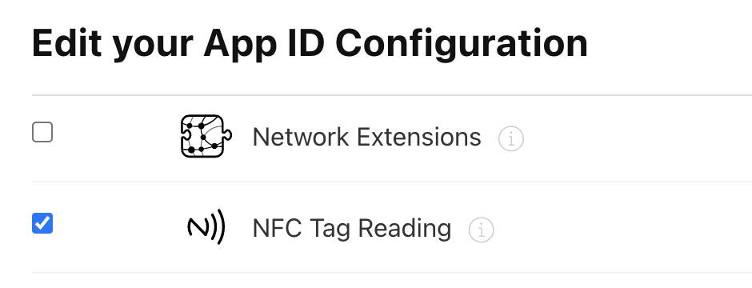
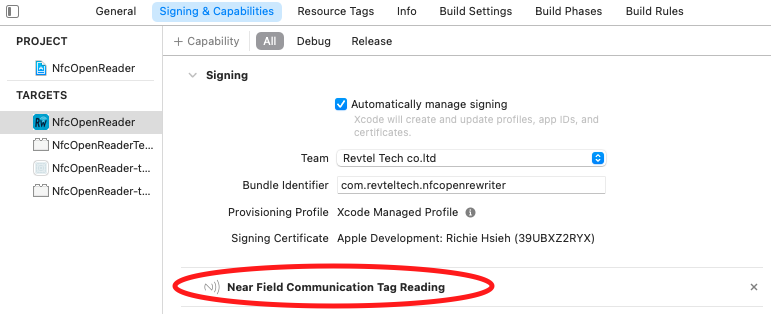
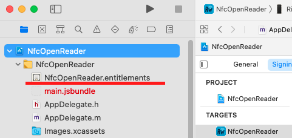
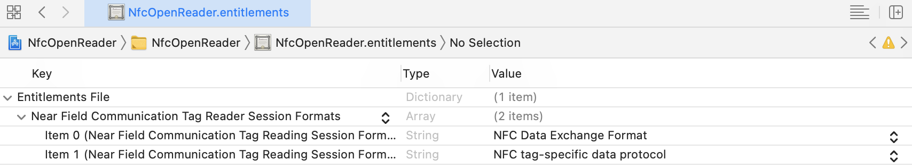
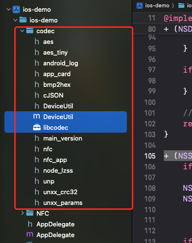

# iOS Demo
iOS 示例应用，演示如何通过 NFC 与 Milesight 设备进行通信，实现 Flash 数据的读取与写入功能。仅支持IPSOV1设备。
## NFC接入

### 设置

1. In [apple developer site](https://developer.apple.com/), enable capability for NFC



2. 在Xcode中，添加 将 `NFCReaderUsageDescription` 添加到您的 `info.plist` 中，例如：

```
<key>NFCReaderUsageDescription</key>
<string>We need to use NFC</string>
```

更多关于苹果的[文档](https://developer.apple.com/documentation/bundleresources/information_property_list/nfcreaderusagedescription?language=objc)信息。

另外，如果编写ISO7816标签，根据需要将应用程序标识符（aid）添加到您的`info.plist`中，如下所示。

```

<key>com.apple.developer.nfc.readersession.iso7816.select-identifiers</key>

<array>

<string>D2760000850100</string>

<string>D2760000850101</string>

</array>

```

更多关于苹果的[文档](https://developer.apple.com/documentation/corenfc/nfciso7816tag)信息。

**注意：**如果您使用`NfcTech.FelicaIOS`，您还必须在`Info.plist`文件中添加以下代码，否则库将崩溃：

```xml

<key>com.apple.developer.nfc.readersession.felica.systemcodes</key>

<array>

<string>8005</string>

<string>8008</string>

<string>0003</string>

<string>fe00</string>

<string>90b7</string>

<string>927a</string>

<string>12FC</string>

<string>86a7</string>

</array>

```

aid的不完整列表可以在此处找到。[应用程序标识符](https://www.eftlab.com/knowledge-base/complete-list-of-application-identifiers-aid)

3. 在Xcode的“签名与能力”选项卡中，确保已添加“近场通信标签读取”能力，如下所示：



如果您第一次切换能力，Xcode将为您生成一个`<your-project>.entitlement`文件：



4. 在Xcode中，检查生成的权限。它应该看起来像这样：



更多关于苹果的[文档](https://developer.apple.com/documentation/bundleresources/entitlements/com_apple_developer_nfc_readersession_formats?language=objc)信息。

## codec编解码库接入
- 将codec文件夹引入到您的项目中，保证`DeviceUtil.m`跟`libcodec.xcframework`引入到您的项目target中


### 使用

#### readFlash - 读取设备 Flash 数据

`readFlash` 方法用于从 NFC 设备读取 Flash 数据，包括设备配置信息和原始数据。

#### 调用方法

在 `ViewController` 中，通过 `NFCService` 实例调用 `readFlashWithCallback` 方法：

```objective-c
- (void)readAction {
    [self.service readFlashWithCallback:^(Boolean success, NSDictionary *flashInfo, NSArray *flashData) {
        if (success) {
            NSLog(@"read flash success");
            self.rawData = flashData;
            self.flashInfo = [flashInfo mutableCopy];
            self.buttonlightLabel.text = [NSString stringWithFormat:@"buttonLight:%@", [self.flashInfo objectForKey:@"buttonLight"]];
        } else {
            NSLog(@"read flash failed");
        }
    }];
}
```

#### 实现步骤

`readFlashWithCallback` 方法的完整实现流程如下：

1. **启动 NFC 检测**
   - 调用 `startDetectionWithCallback` 方法检测 NFC 标签
   - 请求 MiFare 标签类型的技术支持
   - 等待 0.3 秒后获取标签实例

2. **发送读取 Flash 命令**
   - 调用 `sendCommand:NFC_COMMAND_READ_FLASH` 发送读取命令
   - 命令格式：`APP_NFC_COMMAND_PREFIX() + APP_NFC_READ_PKT + "05"`
   - 在发送命令前检查设备是否可写（`checkWriteableWithCallback`）
   - 发送命令后检查设备是否可读（`checkReadableWithCallback`）

3. **获取数据长度**
   - 通过 `getAckDataLengthWithCallback` 方法获取待接收数据的长度
   - 发送 ACK 命令（`NFC_COMMAND_ACK`）获取响应
   - 从响应的第 10-13 字节解析出数据长度（小端序 32 位整数）

4. **接收完整数据**
   - 调用 `receiveDataWithLength` 方法接收数据
   - 根据数据长度计算需要接收的次数：`ceil(length / 64.0)`
   - 每次接收前检查设备可读性（`checkReadableWithCallback`）
   - 通过 `NFC_COMMAND_RECEIVE_DATA` 命令循环接收数据块（每块最多 64 字节）
   - 将所有接收的数据块合并到结果数组中

5. **解析 Flash 数据**
   - 从完整响应数据中提取有效部分：`sliceData = response[0:length]`
   - 提取原始数据：`rawData = sliceData[128:]`（跳过前 128 字节的头部信息）
   - 使用 `DeviceUtil.getFlashInfo` 方法解析 Flash 信息
   - 该方法调用底层的 `get_flash_base_info` C 函数，将原始字节数组转换为 JSON 字典

6. **返回结果**
   - 成功时返回：`callback(YES, flashInfo, rawData)`
   - 失败时返回：`callback(NO, nil, nil)`
   - 最后调用 `cancelTechnologyRequest` 取消 NFC 请求

---

#### writeFlash - 写入设备 Flash 数据

`writeFlash` 方法用于向 NFC 设备写入新的配置信息到 Flash 中。

#### 调用方法

在 `ViewController` 中，通过 `NFCService` 实例调用 `writeFlash` 方法：

```objective-c
- (void)writeAction {
    if (self.inputText.text.length == 0) {
        NSLog(@"please enter button light value");
        return;
    }
    NSInteger buttonLight = [self.inputText.text integerValue];
    NSDictionary *newDeviceSettingInfo = @{@"buttonLight": @(buttonLight)};
    [self.service writeFlash:newDeviceSettingInfo 
         newDeviceSettingInfo:newDeviceSettingInfo 
                      rawData:self.rawData 
                     callback:^(Boolean success) {
        if (success) {
            NSLog(@"write flash success");
        } else {
            NSLog(@"write flash failed");
        }
    }];
}
```

**参数说明：**
- `settingJSON`: 要写入的设备设置信息（字典格式）
- `newDeviceSettingInfo`: 新的设备设置信息（与 settingJSON 相同）
- `rawData`: 之前通过 `readFlash` 获取的原始数据数组
- `callback`: 写入完成后的回调函数

#### 实现步骤

`writeFlash` 方法的完整实现流程如下：

1. **参数验证**
   - 检查 `rawData` 是否为空，如果为空则直接返回失败

2. **启动 NFC 检测**
   - 调用 `startDetectionWithCallback` 方法检测 NFC 标签
   - 请求 MiFare 标签类型的技术支持
   - 等待 0.3 秒后获取标签实例

3. **合并 Flash 数据**
   - 调用 `DeviceUtil.setFlashInfo` 方法将新的设置信息合并到原始数据中
   - 该方法调用底层的 `set_flash_base_info` C 函数
   - 输入参数：原始数据数组和 JSON 字符串格式的新设置信息
   - 返回结果包含：
     - `code`: 操作结果代码（1 表示成功）
     - `rawData`: 合并后的新原始数据数组
     - `result`: JSON 字符串，包含 `datasize`（数据大小）等信息

4. **发送写入 Flash 命令**
   - 从合并结果中提取 `datasize`（数据大小）
   - 调用 `sendCommand:NFC_COMMAND_WRITE_FLASH` 发送写入命令
   - 命令参数包括：
     - `datasize`: 要写入的数据大小
     - `password`: 设备密码（默认 "123456"）
   - 命令格式：`APP_NFC_COMMAND_PREFIX() + APP_NFC_WRITE_PKT + APP_NFC_WRITE_FLASH + datasize(4字节) + "0000" + password(6字节)`
   - 在发送命令前检查设备是否可写（`checkWriteableWithCallback`）
   - 发送命令后检查设备是否可读（`checkReadableWithCallback`）
   - 获取 ACK 响应确认命令已发送

5. **分块发送 Flash 数据**
   - 调用 `sendFlashData` 方法发送合并后的新原始数据
   - 根据数据大小计算需要发送的次数：`ceil(dataSize / 64.0)`
   - 每次发送前：
     - 检查设备可写性（`checkWriteableWithCallback`）
     - 提取 64 字节的数据块
     - 添加命令前缀（`APP_NFC_SEND_DEVICE_COMMAND`）
     - 将数据填充到 67 字节（不足部分补 0）
   - 通过 `createCheckFunc` 发送数据并检查响应
   - 递归调用直到所有数据块发送完成

6. **验证写入结果**
   - 调用 `checkReadableWithCallback` 检查设备是否可读
   - 调用 `checkWriteSuccessWithCallback` 验证写入是否成功
   - 发送 ACK 命令检查响应：
     - 响应第 9 字节为 0 表示无错误
     - 响应第 1 字节为 60 (0x3C) 表示成功

7. **返回结果**
   - 成功时返回：`callback(YES)`
   - 失败时返回：`callback(NO)`
   - 最后调用 `cancelTechnologyRequest` 取消 NFC 技术请求

#### 关键代码位置

- 方法定义：`ios-demo/ios-demo/NFC/NFCService.m` 第 59-111 行
- 数据发送：`ios-demo/ios-demo/NFC/NFCService.m` 第 113-154 行
- Flash 数据合并：`ios-demo/ios-demo/codec/DeviceUtil.m` 第 39-54 行
- 写入验证：`ios-demo/ios-demo/NFC/NFCService.m` 第 343-359 行

#### 注意事项

1. **必须先读取后写入**：`writeFlash` 需要 `readFlash` 获取的 `rawData` 作为输入，不能直接写入新数据
2. **数据完整性**：写入过程会保持原有 Flash 数据的完整性，只更新指定的配置字段
3. **密码验证**：写入时需要提供正确的设备密码（默认 "123456"）
4. **错误处理**：如果写入过程中任何一步失败，都会取消 NFC 会话并返回失败
5. **进度跟踪**：写入过程会更新进度信息，通过 KVO 机制通知 UI 更新

